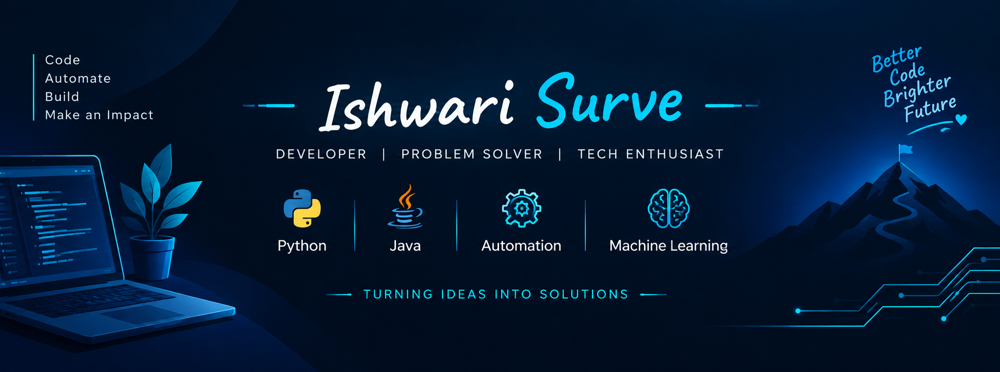

   

 
---

# 👋 Hii, I'm Ishwari Surve! 
  

  

  <b>💻 Developer</b> &nbsp; • &nbsp;
  <b>⚙️ Automation Enthusiast</b> &nbsp; • &nbsp;
  <b>🧠 Machine Learning</b>

  
  

---

## 💫 About Me

💻 Programmer with hands-on experience in **C, C++, Java, and Python**.

🤖 Interested in building **automation tools and practical software solutions**.

🧠 Exploring **Machine Learning** with Python, NumPy, Pandas, and Scikit-learn.

🛠️ Focused on problem-solving, writing clean code, and developing real-world projects.

🎯 Currently seeking opportunities to apply my programming and technical skills to meaningful projects.

---

## 🚀 Featured Projects

<table>
  <tr>
    <td width="50%" valign="top">
      <h3>🧠 Applied ML Workbench</h3>
      
Machine-learning case studies, experiments, and practical implementations.

      
      
      
<a href="https://github.com/ishwari-surve/Applied-ML-Workbench">Explore Project →</a>

    </td>
    <td width="50%" valign="top">
      <h3>🛡️ Secure Automated Data Shield</h3>
      
Automated backups with MD5 change detection, timestamped archives, and scheduled execution.

      
      
      
<a href="https://github.com/ishwari-surve/Secure-Automated-Data-Shield">Explore Project →</a>

    </td>
  </tr>
  <tr>
    <td width="50%" valign="top">
      <h3>🧹 Automated Directory Cleaner</h3>
      
Scans directories, removes empty files, and generates timestamped cleanup logs.

      
      
      
<a href="https://github.com/ishwari-surve/Automated-Directory-Cleaner">Explore Project →</a>

    </td>
    <td width="50%" valign="top">
      <h3>📡 Platform Surveillance System</h3>
      
Periodic system monitoring with automated logging.

      
      
      
<a href="https://github.com/ishwari-surve/Automated-Platform-Surveillance-System">Explore Project →</a>

    </td>
  </tr>
  <tr>
    <td colspan="2" valign="top">
      <h3>🔍 Automated Duplicate File Detector</h3>
      
Identifies duplicate files using MD5 checksums and removes redundant copies.

      
      
      
<a href="https://github.com/ishwari-surve/Automated-Duplicate-File-Detector">Explore Project →</a>

    </td>
  </tr>
</table>

---

## 💻 Developer Terminal

  

  

  
  
  
  

  <strong>“Great things are built one line of code at a time.”</strong>

---

## 🛠️ Tech Stack

**Programming Languages**

  
  
  
  

**Data & Machine Learning**

  
  
  
  

**Tools & Technologies**

  
  
  
  

---

## 📊 GitHub Analytics

  
  

  

---

## 🟡 Pac-Man Contribution Graph

  <picture>
    <source media="(prefers-color-scheme: dark)" srcset="https://raw.githubusercontent.com/ishwari-surve/ishwari-surve/output/pacman-contribution-graph-dark.svg">
    <source media="(prefers-color-scheme: light)" srcset="https://raw.githubusercontent.com/ishwari-surve/ishwari-surve/output/pacman-contribution-graph.svg">
    
  </picture>

---

## 🤝 Let's Connect!

  
  
  

  ✨ Thanks for visiting! Keep building, keep exploring, and keep creating.

